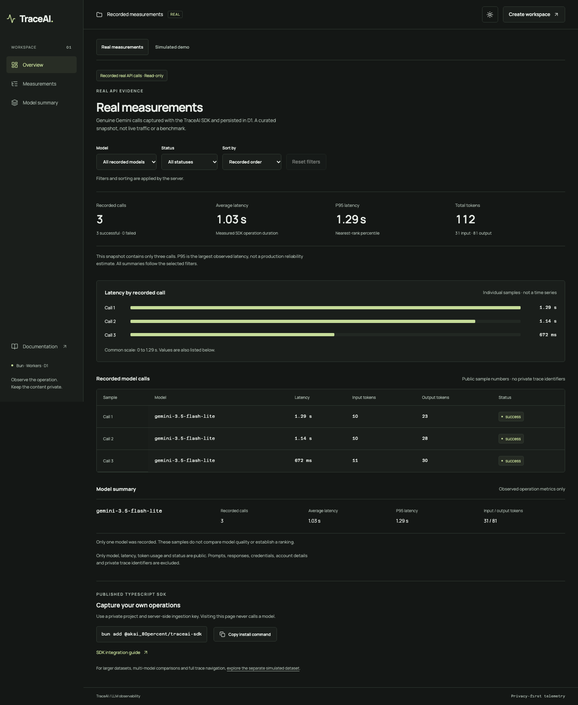

# TraceAI

[](https://github.com/Metricra-code/traceai/actions/workflows/ci.yml)

A privacy-first LLM observability portfolio: a standalone TypeScript SDK, a usable React dashboard,
and project-scoped analytics on Cloudflare Workers/D1. No paid AI credentials are needed.

**[Open real model measurements](https://traceai-web.traceai-api.workers.dev/showcase)** ·
[Explore the separate simulated demo](https://traceai-web.traceai-api.workers.dev/demo) ·
[API health](https://traceai-api.traceai-api.workers.dev/health) ·
[GitHub source](https://github.com/Metricra-code/traceai)



Latest verified runtime release (2026-10-11 Taipei): **418 unit tests**, **75 actual Worker/D1 cases**,
and **30/30 Playwright journeys in each of native Next, built-workerd and deployed HTTPS modes**.
[Runtime-source CI](https://github.com/Metricra-code/traceai/actions/runs/38073302408) passed for `1ae1602`
before manual deployment. The repeated live SDK + genuine OpenTelemetry → Worker → D1 smoke verifies
sourced pricing, privacy, deduplication and revoked keys using synthetic verification operations.
The [verification record](docs/verification.md#recorded-real-showcase--published-and-live-2026-10-11-taipei)
retains the initial failed rollout and measurement limits; a passing run is not an SLA.

## Real measurements and a separate simulated demo

The main entry opens `/showcase`: **three genuine Gemini REST calls**, captured by the published
SDK, persisted in D1 and read back before a strict owner-approved public projection. It shows actual
model, operation latency, token usage and status, plus server-side model/status filters and latency
sorting. A recorded snapshot is **not live traffic**; with three samples P95 equals the maximum,
and one recorded model is not a quality comparison or production benchmark.

The original `/demo` remains a separate, clearly simulated 10,000-row interactive dataset for
multi-model comparisons, trace detail, date filters and pagination. Both pages link to each other.
Visiting either page never calls an AI model. The real snapshot contains no private project/trace IDs,
account information, prompt/response content, keys, metadata or fabricated costs.
[Data boundary and verification](docs/demo.md#recorded-real-measurements--separate-public-entry).

## Public TypeScript SDK

[`@akai_80percent/traceai-sdk@0.1.0`](https://www.npmjs.com/package/@akai_80percent/traceai-sdk)
is published and verified from the public registry in fresh Bun/Node consumers with strict types.

```sh
bun add @akai_80percent/traceai-sdk@0.1.0
```

The follow-up adds real Gemini Free Tier evidence: **3 actual API calls and private-project
read-back**, 31 input / 81 output tokens, no prompt/answer capture and unknown cost.
The anonymous demo remains simulated. [Real-data evidence](docs/gemini.md) ·
[Release integrity and verification](docs/npm.md).
The [credential-isolation release CI](https://github.com/Metricra-code/traceai/actions/runs/37989793103)
passed its historical **343 unit / 73 Worker-D1 / 17 native + 17 built-workerd** gates, including
installed-consumer containment regressions; the latest expanded counts are above. Real provider calls
and npm registry verification remain separate manual evidence, not work performed by CI.
The core SDK artifact remains `0.1.0`; the optional OpenTelemetry adapter is not published.

## What to explore

- **SDK engineering:** original async results/errors preserved; bounded batching, full-jitter retry,
  timeouts, `flush()` singleflight, deterministic shutdown and acknowledged completed-event receipts.
  [Design, concurrency benchmark and tests](docs/sdk.md).
- **Dashboard:** real API-backed Average/P95, request/latency/token/cost charts, provider-qualified model
  comparison, exact trace search, server-side filters, cursor pagination and safe operation detail.
  Applied UTC investigation windows, Back/Forward restoration and cancellable requests preserve context.
  Persistent themes, keyboard account menu and responsive loading/error/empty states are usable.
- **Management:** email/password sessions, owned projects, one-time ingestion keys, rotation/revocation
  and confirmed deletion. Keys never belong in a browser bundle.
- **Public demo:** 10,000 deterministic simulated traces, clearly labeled fictional prices,
  working filters and detail pages, no authentication or write privileges.
- **Sourced pricing/debugging:** immutable verified base-text snapshots, per-trace provenance and
  explicit opt-in redacted error summaries. Unknown prices stay unknown; estimates are not bills.
- **Optional OpenTelemetry:** genuine GenAI `SpanExporter` with actual span IDs/timing, privacy
  allowlist and honest delivery lifecycle. [No-credential OTel example](docs/opentelemetry.md).
- **Real Gemini integration:** a bounded, explicit opt-in Bun example uses your own Free Tier provider
  credentials and owned project; actual usage includes thinking tokens when reported. It never relabels
  the simulated public demo. [Setup and verification gates](docs/gemini.md); a live run requires your keys.
- **Engineering evidence:** architecture diagram, strict TypeScript, Vitest, actual Worker/D1 integration,
  Playwright journeys and GitHub Actions. [Evidence and measurement limits](docs/verification.md).

## Run locally

Requirements: **Bun 1.4.0 and Node >=22** for supported Cloudflare/tooling CLIs.
Bun owns installation, workspaces, scripts, the local Next runtime and TypeScript examples;
production executes in Cloudflare workerd. Use `bun run test` for Vitest, not the separate `bun test` runner.
The verified pair is Next **16.3.8** with OpenNext **1.20.9**. An earlier Next 16.4 build failed
in workerd on a missing manifest ([upstream compatibility fix](https://github.com/opennextjs/opennextjs-cloudflare/pull/1356)).
This project retains its tested pin; any upgrade must pass actual workerd dynamic-route checks.
Build success alone did not catch that historical regression.

```sh
bun install --frozen-lockfile
bun run db:migrate
bun run db:pricing --local
bun run db:seed
bun run dev
```

Open [the recorded-real entry](http://localhost:3000/showcase), then switch to
[the separate read-only demo](http://localhost:3000/demo) and choose **Last 30 days** to see all 10,000 simulated traces.
[Create an account](http://localhost:3000/register), create a project, and generate an ingestion key to
try the real SDK → Worker → D1 path. Follow [SDK integration](docs/sdk.md) for the mock-provider example.
[Worker health](http://127.0.0.1:8787/health) confirms the local D1 connection.

The seed is simulated, not an AI benchmark or production traffic. Normal ingestion never uses demo prices;
the operator-imported [sourced pricing registry](docs/pricing.md) supplies verified base text-token rates;
unknown models or incomplete usage return `null` costs rather than misleading `$0` values.
The separately labeled priced-only subtotal excludes unknown prices and is never a complete grand total.

## Validate

```sh
bun run format:check
bun run lint
bun run typecheck
bun run test
bun run test:integration
bun run build
bun run test:packages
bunx --no-install playwright install chromium
bun run test:e2e
bun run --filter @traceai/web build:cloudflare
bun run test:e2e:workers
```

Migrations/demo seed are required before local E2E. `test:e2e:workers` checks the built OpenNext app
in actual workerd, not Next development mode. CI runs both paths without automatic deployment;
failed Playwright runs retain trace/report artifacts. Test source is not proof that its current run passed.

## Architecture and boundaries

- `apps/web`: Next.js App Router feature modules (React Query, Recharts) and a same-origin API proxy;
  lint enforces one-way imports between `app/`, `features/`, `components/` and `lib/`.
- `apps/api`: Hono routes → services → D1 repositories (services never see the HTTP context);
  private password-hashing Durable Object. [Source layout](docs/architecture.md#source-layout-and-dependency-rules).
- `packages/sdk`: framework-independent public ESM package; Zod is its only runtime dependency.
- `packages/opentelemetry`: optional server-side GenAI exporter; the core SDK has no OTel dependency.
- `packages/shared`: strict Zod contracts, nearest-rank percentiles and integer monetary arithmetic.
- `packages/database`: Drizzle schema, indexed D1 migrations and deterministic demo seed.
- `examples`: native-Bun mock operations, genuine OTel provider and reproducible SDK overhead benchmark.

Passwords use native scrypt in a **private SQLite-backed Durable Object**, not weakened edge PBKDF2.
Session cookies are HttpOnly/SameSite and Secure in production. Every private analytics/management request
checks ownership; cookie mutations validate Origin. No prompts, responses or raw original errors are
captured by default. Explicit metadata/summaries remain your privacy responsibility; sanitization is
best-effort, not an arbitrary-PII guarantee. Ingestion keys are temporarily revealed once in Settings,
never embedded in bundles or persisted in client storage. Only expired auth state is removed by
bounded maintenance; user traces remain until confirmed project deletion.

## Documentation and limits

[Architecture](docs/architecture.md) · [SDK](docs/sdk.md) · [API](docs/api.md) · [Demo](docs/demo.md) ·
[Deployment](docs/deployment.md) · [Verification](docs/verification.md) · [Requirements](docs/product-spec.md) ·
[Acceptance ledger](docs/acceptance.md) · [Troubleshooting](docs/troubleshooting.md) · [Operations](docs/operations.md) ·
[Pricing](docs/pricing.md) · [OpenTelemetry](docs/opentelemetry.md) · [Roadmap](docs/roadmap.md) ·
[Real Gemini data](docs/gemini.md) · [npm publication](docs/npm.md) ·
[面試展示導覽](docs/interview-guide.md)

[GitHub source](https://github.com/Metricra-code/traceai). The full specified product is a portfolio,
not an enterprise SLA:
SDK delivery is in-memory/best-effort; analytics reject windows over 31 days or 20,000 matching rows;
Free-tier quotas require monitoring. No automatic deployment, paid AI dependency, model-quality claims,
password reset/MFA, OTLP collector, metrics/log backend or distributed span tree.
The core SDK `0.1.0` is published to npm; the optional OpenTelemetry adapter remains unpublished.
